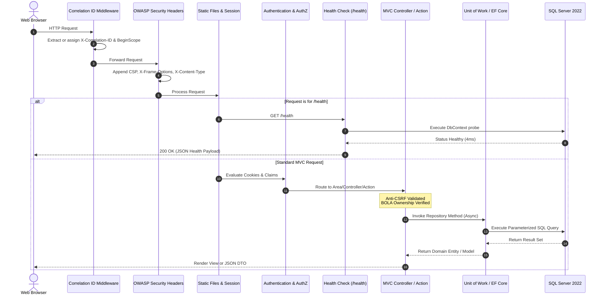

# QuickCart: Architecture & System Design

Last updated: 2026-10-21

## 1. System Overview & Clean Architecture

QuickCart is architected using the ASP.NET Core 8 MVC framework combined with the Generic Repository Pattern and Unit of Work abstraction. The codebase is organized into four distinct projects enforcing strict dependency boundaries:

```
┌─────────────────────────────────────────────────────────────┐
│                          QuickCart                          │
│        (Presentation Layer: Controllers, Views, Areas)      │
└──────────────────────────────┬──────────────────────────────┘
                               │
            ┌──────────────────┴──────────────────┐
            ▼                                     ▼
┌──────────────────────────────┐        ┌──────────────────────────────┐
│     QuickCart.DataAccess     │        │      QuickCart.Utility       │
│  (Data Access, Repositories, │        │   (Static Details, Security, │
│    DbContext, Migrations)    │        │ Stripe, Backblaze B2 Storage)│
└──────────────┬───────────────┘        └──────────────┬───────────────┘
               │                                       │
               └──────────────────┬────────────────────┘
                                  ▼
┌─────────────────────────────────────────────────────────────┐
│                      QuickCart.Models                       │
│             (Domain Entities, ViewModels, DTOs)              │
└─────────────────────────────────────────────────────────────┘
```

---

## 2. HTTP Request & Middleware Pipeline

Every HTTP request enters a hardened ASP.NET Core middleware pipeline designed for security, traceability, and resilience:



---

## 3. Presentation Layer: Area Organization

The web host (`QuickCart`) organizes controllers and Razor views into three logical areas:

1. **`Areas/Customer`:**
   - `HomeController`: Catalog listing, product details, category search.
   - `CartController`: Shopping cart CRUD, item quantity management, order summary, and Stripe checkout initiation.

2. **`Areas/Admin`:**
   - `ProductController`: Product catalog maintenance, image upload to Backblaze B2 S3 cloud storage.
   - `CategoryController`: Product taxonomy classification.
   - `CompanyController`: B2B corporate account management.
   - `OrderController`: Order lifecycle management (Pending, Approved, Processing, Shipped, Cancelled, Refunded).
   - `UserController`: User account authorization, role reassignment, and account lockout.

3. **`Areas/Identity`:**
   - Razor Pages for user authentication: hardened login with lockout, self-registration restricted to customers, and access denied handlers.
   - Multi-provider OAuth integration (`Google`, `Facebook`) adapted from Flexfolio with automatic verified email account linking.

---

## 4. Data Access Layer & Unit of Work

The data access layer encapsulates Entity Framework Core 8 through:
- **`IRepository<T>` & `Repository<T>`:** Generic abstraction providing asynchronous operations (`GetAllAsync`, `GetAsync`, `AddAsync`, `Remove`).
- **`IUnitOfWork` & `UnitOfWork`:** Aggregates repository instances (`Product`, `Category`, `ShoppingCart`, `OrderHeader`, `OrderDetail`, `ApplicationUser`) and commits changes via a unified asynchronous transaction boundary (`SaveAsync()`).
- **`DbInitializer`:** Automatically migrates pending EF Core migrations on application startup and seeds default roles and administrator accounts.
