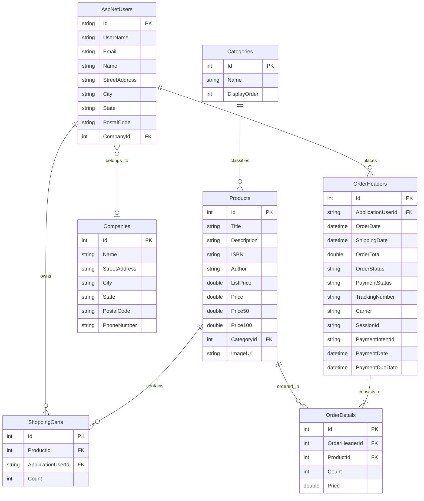

# QuickCart: Database Schema & Migrations

Last updated: 2026-10-21

## 1. Entity Relationship Diagram (ERD)



---

## 2. Table Specifications & Indexes

### Products
- **Primary Key:** `Id` (int, identity)
- **Foreign Keys:** `CategoryId` -> `Categories(Id)` on delete cascade.
- **Indexes:**
  - `IX_Products_CategoryId` (Foreign key lookup)
  - `IX_Products_Title` (Catalog search performance)

### OrderHeaders
- **Primary Key:** `Id` (int, identity)
- **Foreign Keys:** `ApplicationUserId` -> `AspNetUsers(Id)`
- **Key Columns:**
  - `OrderStatus`: Tracks lifecycle (`Pending`, `Approved`, `Processing`, `Shipped`, `Cancelled`, `Refunded`).
  - `PaymentStatus`: Tracks financial state (`Pending`, `Approved`, `DelayedPayment`, `Rejected`).
  - `SessionId` & `PaymentIntentId`: External Stripe identifiers.
- **Indexes:**
  - `IX_OrderHeaders_ApplicationUserId` (Customer order history queries)
  - `IX_OrderHeaders_OrderStatus` (Admin order dashboard filtering)

### ShoppingCarts
- **Primary Key:** `Id` (int, identity)
- **Foreign Keys:**
  - `ProductId` -> `Products(Id)`
  - `ApplicationUserId` -> `AspNetUsers(Id)`
- **Indexes:**
  - `IX_ShoppingCarts_ApplicationUserId` (Cart retrieval by user)

---

## 3. Migration Strategy & Bundle Execution

### Development
EF Core migrations are authored against `QuickCart.DataAccess`:
```bash
dotnet ef migrations add <Name> --project QuickCart.DataAccess --startup-project QuickCart
dotnet ef database update --project QuickCart.DataAccess --startup-project QuickCart
```

### Production Idempotent Bundle (`docs/migrations/bundle.sql`)
For production environments, direct application migration on startup is discouraged. Instead, an idempotent SQL script is executed via CI/CD pipelines:
```bash
# Generate idempotent script:
dotnet ef migrations script --idempotent --project QuickCart.DataAccess --startup-project QuickCart -o docs/migrations/bundle.sql

# Execute against production database:
sqlcmd -S <server> -d QuickCartDb -U <user> -P <pass> -i docs/migrations/bundle.sql
```
The script uses `IF NOT EXISTS (SELECT * FROM [__EFMigrationsHistory] ...)` checks before applying every table or schema alteration, ensuring zero-risk repeated executions.

---

## 4. Idempotent Data Seeding (`DbInitializer`)

The `IDbInitializer` (`DbInitializer.cs`) runs on application startup:

1. **Pending Migrations:** Automatically executes `Database.Migrate()` if running against a relational database with pending migrations.
2. **Identity Roles & Admin:** Seeds system roles (`Admin`, `Customer`, `Employee`, `Company`) and provisions default administrative credentials from `AdminUser` configuration.
3. **Curated Categories:** Ensures literary categories exist (*Classics*, *Sci-Fi & Fantasy*, *History & Thought*, *Technology*, *Self-Development*).
4. **Placeholder Pruning:** Deletes obsolete demo placeholders ("Fortune of Time", "Dark Skies", etc.) provided they are not attached to active orders or shopping carts.
5. **Authentic Book Catalog:** Seeds 12 world-renowned books with verified ISBN-13s, rich editorial descriptions, tiered volume pricing ($1–$100), and links to local cover artwork in `wwwroot/images/books/`. Ensures idempotency by checking `ISBN` and `Title` before inserting.

